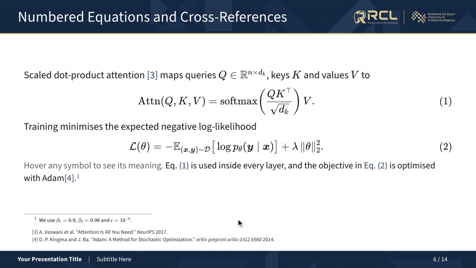
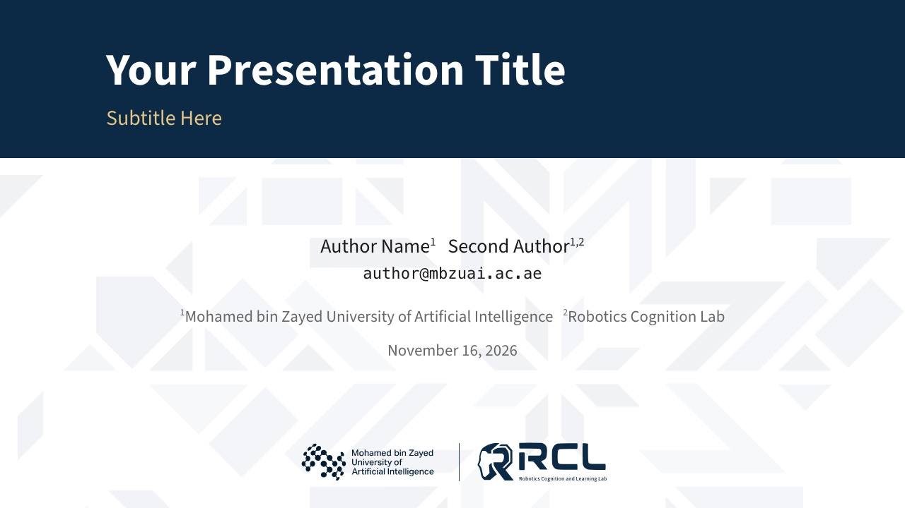
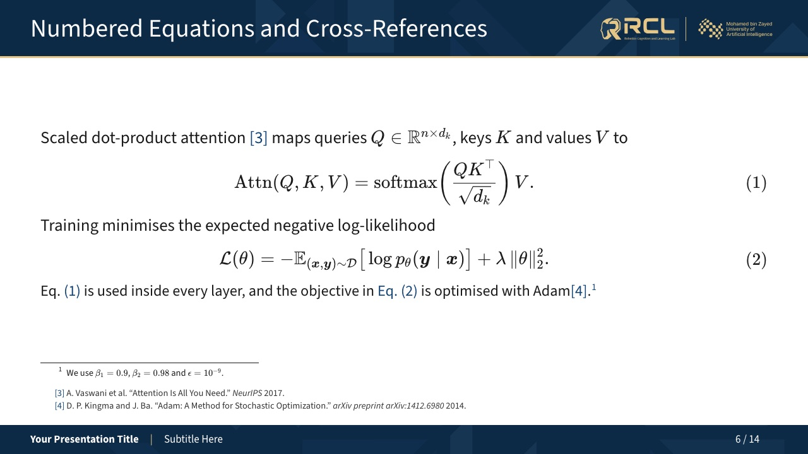
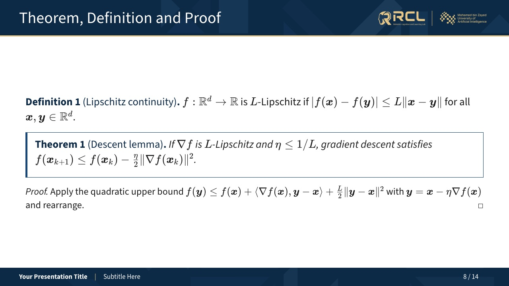
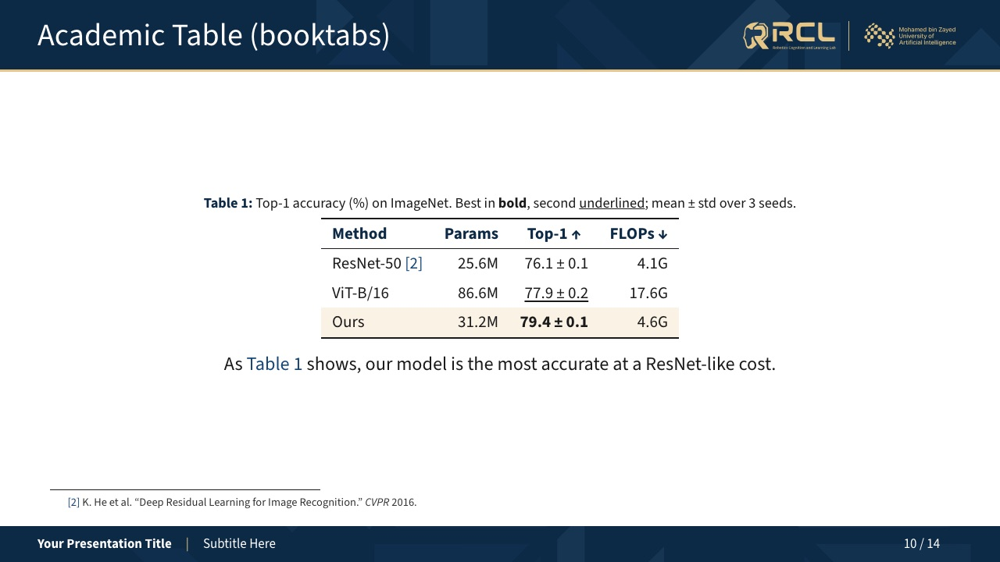
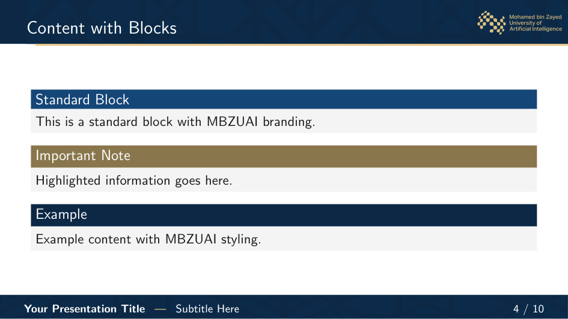
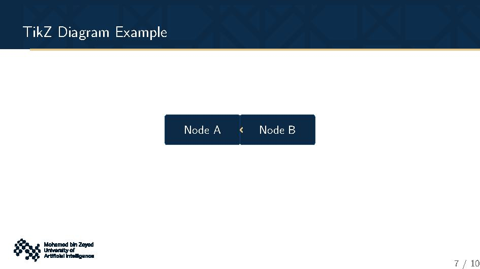
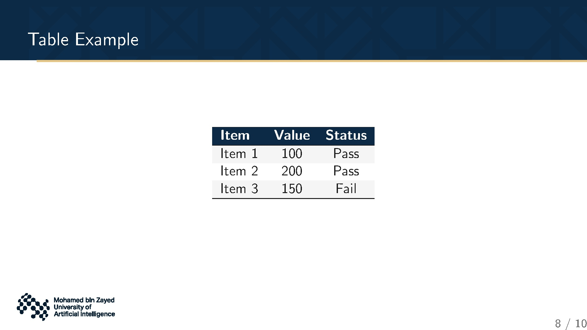

# MBZUAI Slides Theme (Beamer + HTML)

<p align="center">
  
  <br><em>HTML slides with KaTeX math. Point at any symbol in a formula to see what it means. <a href="http://www.micdz.cn/MBZUAI_Beamer_Theme/html/demo.html">Live demo →</a></em>
</p>

A presentation theme based on the **Mohamed bin Zayed University of Artificial Intelligence (MBZUAI)** brand guidelines (March 2026, V1), available in two forms that look the same:

- **LaTeX Beamer theme**: `beamertheme*.sty` (described below)
- **HTML slides theme**: [`html/`](html/). Agents can write it as plain HTML. Math is rendered with **KaTeX**, and equations, citations, footnotes, figures and theorems follow academic conventions. See [HTML Slides](#html-slides) and the [authoring guide](html/AUTHORING.md).

## Features

- 🎨 Official MBZUAI brand colors
- 📐 16:9 widescreen layout
- 🖼️ Frametitle banner with subtle pattern background
- 📄 Custom title page and "Thank You" slide
- 🧱 Styled blocks (standard, alert, example)
- 📊 Brand-colored tables
- 🔷 Diamond bullet markers in table of contents

## HTML Slides

The `html/` directory contains an HTML/CSS/JS version of the theme. A deck is one HTML file with one
`<section class="slide">` per slide on a fixed 1280×720 canvas. It is meant to be written by coding agents
as well as by people.

<p align="center">
  
  
</p>
<p align="center">
  
  
</p>

**Live demo:** <http://www.micdz.cn/MBZUAI_Beamer_Theme/html/demo.html>. Use ← → to navigate and `o` for the overview.

**Academic typesetting**

- **KaTeX math**: `$…$`, `\(…\)`, `$$…$$`, `\[…\]`, `\begin{equation|align|gather}`, `\label`/`\eqref`, `\tag`, and deck-wide macros. Numbered equations put "(1)" at the right margin, as amsmath does.
- **Citations from BibTeX** pasted into the page: numeric `[1–3]` (unsrt order) or author-year `(Vaswani et al., 2017)` (natbib), `\cite`/`\citet`/`<cite>`, short full references at the bottom of each slide, and an auto-paginated References slide.
- **Notation hover**: hover any symbol in a formula to see what it means, with every occurrence on the slide highlighted. Meanings come from a deck glossary, from notation tables (harvested automatically), or from inline `\explain{…}{…}`.
- **Footnotes**: superscript markers, with notes below a LaTeX-style footnote rule at the bottom of the slide (numbers or `* † ‡`).
- **Numbered** figures, tables, algorithms and theorem-like environments (amsthm style), with `\cref`/`\ref`-style cross-references that jump to the target slide.
- Booktabs tables, Beamer-style blocks, source locators, section dividers, an outline, and fragments (`\pause`).

**Built for agents**

- The markup is plain semantic HTML, and LaTeX habits (`\cite{}`, `\eqref{}`, `\footnote{}`, `\begin{align}`) work directly in the text.
- A QA report (`window.MBZUAI.report` and `<script id="mbz-report">`) lists overflowing slides, missing citations and labels, KaTeX errors, and raw `<` inside math.
- `html/tools/check.sh` (QA, non-zero exit on problems), `screenshot.sh` (PNG per slide) and `export-pdf.sh` (16:9 PDF) use headless Chrome.

**Quick start**

```bash
cp -r html/ my-talk/theme/
cp html/demo.html my-talk/index.html     # then change the CSS/JS paths to theme/…
open my-talk/index.html                  # ← → to navigate, o = overview, f = fullscreen
html/tools/check.sh my-talk/index.html   # QA report
html/tools/export-pdf.sh my-talk/index.html
```

A minimal deck:

```html
<link rel="stylesheet" href="https://cdn.jsdelivr.net/npm/katex@0.16.11/dist/katex.min.css">
<link rel="stylesheet" href="theme/mbzuai-slides.css">
<script defer src="https://cdn.jsdelivr.net/npm/katex@0.16.11/dist/katex.min.js"></script>
<script defer src="theme/mbzuai-slides.js"></script>
<script type="text/x-bibtex">@inproceedings{vaswani2017attention, …}</script>

<main class="deck" data-short-title="My Talk">
  <section class="slide title-slide">
    <h1>Your Presentation Title</h1><p class="subtitle">Subtitle</p>
    <p class="author">Author Name</p><p class="institute">MBZUAI</p><p class="date">2026</p>
  </section>
  <section class="slide" data-section="Method">
    <h2>Scaled Dot-Product Attention</h2>
    <p>Following \cite{vaswani2017attention}, attention is</p>
    <div class="equation" id="eq:attn">\operatorname{softmax}\!\left(QK^\top/\sqrt{d_k}\right)V</div>
    <p>We use Eq.&nbsp;\eqref{eq:attn} in every layer.<span class="footnote">With 8 heads.</span></p>
  </section>
  <section class="slide references"><h2>References</h2></section>
  <section class="slide closing-slide"></section>
</main>
```

The full feature reference is in [`html/AUTHORING.md`](html/AUTHORING.md). `html/demo.html` exercises every feature, and
[`templates/paper-presentation.html.in`](templates/paper-presentation.html.in) is the HTML version of the paper-talk template.

---

# Beamer Theme

## Preview

<p align="center">
  
  
</p>
<p align="center">
  
  
</p>

## Installation

### Option 1: Local (recommended)

Copy the `beamerthemeMBZUAI/` directory to your project:

```bash
cp -r beamerthemeMBZUAI/ /path/to/your/project/
```

### Option 2: TeXMF (system-wide)

```bash
cp -r beamerthemeMBZUAI/ ~/Library/texmf/tex/latex/beamer/
```

## Usage

```latex
\documentclass[aspectratio=169, 11pt]{beamer}

\usetheme{MBZUAI}

\title[Short Title]{Your Presentation Title}
\subtitle{Subtitle Here}
\author[Author Name]{Author Name \\ \texttt{author@mbzuai.ac.ae}}
\institute[MBZUAI]{Mohamed bin Zayed University of Artificial Intelligence}
\date{\today}

\begin{document}

% Title slide (automatic)
\begin{frame}[t]
\titlepage
\end{frame}

% Content slides
\section{Introduction}
\begin{frame}{Introduction}
    \begin{itemize}
        \item Your content here
    \end{itemize}
\end{frame}

% Thank You slide
{
\setbeamertemplate{footline}{}
\setbeamertemplate{frametitle}{}
\begin{frame}[t]
    \mbzuaiThankYou
\end{frame}
}

\end{document}
```

## Research Paper Presentation Template

`templates/paper-presentation.tex.in` provides an evidence-driven 16:9 paper-talk starter used by the companion [paper-presentation-slides skill](https://github.com/MicDZ/paper-presentation-slides-skill). It includes:

- explicit paper-author and presenter attribution;
- configurable left, center, and right footer fields;
- question/thesis, method, evaluation, evidence, and assessment frame patterns;
- a formula frame with a visible notation table and operational-meaning block;
- compact frame-level source locators;
- the standard MBZUAI title and closing frames.

`templates/paper-presentation.html.in` is the same template for the HTML theme. It uses the same placeholders and expects the `html/` directory to be copied to `theme/` next to the deck.

The `.tex.in` file uses `@@NAME@@` placeholders for the companion initializer. New projects fetch the template and theme from this repository, record the resolved Git commit, and keep a local copy so the generated deck remains reproducible. Existing projects can refresh the theme files without overwriting their paper-specific `main.tex`.

## Available Colors

| Color | Hex | Usage |
|-------|-----|-------|
| `mbzuai-dark-navy` | `#0C2945` | Primary backgrounds, headers |
| `mbzuai-navy` | `#154677` | Secondary backgrounds |
| `mbzuai-sand` | `#E5C687` | Accent elements, highlights |
| `mbzuai-dark-sand` | `#8A764D` | Secondary accents |
| `mbzuai-light-gray` | `#F5F5F5` | Block backgrounds |
| `mbzuai-text` | `#1A1A1A` | Body text |
| `mbzuai-subtle` | `#666666` | Secondary text |

Use these colors in your presentation:

```latex
\textcolor{mbzuai-navy}{\textbf{Important text}}
\color{mbzuai-sand} highlighted text
```

## Customization

### Thank You Slide

The `\mbzuaiThankYou` macro creates a "Thank You" slide with:
- Subtle pattern background
- Navy header bar
- "Thank You" title
- "Questions?" subtitle
- Author and institute information

### Title Page

The title page is automatically generated from `\title`, `\subtitle`, `\author`, `\institute`, and `\date`. The title uses `\Huge` font size and automatically scales down when the text is too long to fit the page width.

## Regenerating the Banner

The frametitle banner (`assets/banner-bg.pdf`) is pre-built. To regenerate it:

```bash
cd assets/
pdflatex make-banner-bg.tex
cp make-banner-bg.pdf banner-bg.pdf
```

**Note:** Regenerating requires the MBZUAI pattern asset:
`MBZUAI-Patterns/CROPS/CMYK/PDF/MBZUAI_PATTERN_CROP 01_NAVY_CMYK.pdf`

## Building

**Recommended: use `latexmk` (handles multiple compilations automatically):**

```bash
cd beamerthemeMBZUAI/
latexmk -pdf demo.tex
```

**Or compile manually (at least twice):**

```bash
pdflatex demo.tex
pdflatex demo.tex
pdflatex demo.tex  # Ensures all overlays render correctly
```

> **⚠️ Why multiple compilations?**
>
> The title page and Thank You page backgrounds (pattern, navy bar) use TikZ's `remember picture, overlay` mechanism, which requires node positions to be written to the `.aux` file on the first pass and read back on the second pass. This is inherent to LaTeX.

## File Structure

```
MBZUAI_Beamer_Theme/
├── beamerthemeMBZUAI.sty          # Main theme loader
├── beamercolorthemeMBZUAI.sty     # Brand color definitions
├── beamerinnerthemeMBZUAI.sty     # Title page, Thank You, blocks
├── beamerouterthemeMBZUAI.sty     # Frametitle, footline
├── beamerfontthemeMBZUAI.sty      # Font settings
├── demo.tex                       # Example Beamer presentation
├── html/                          # HTML slides theme
│   ├── mbzuai-slides.css          #   Styles (brand, layout, academic typesetting)
│   ├── mbzuai-slides.js           #   Runtime (KaTeX, numbering, citations, footnotes, viewer, QA)
│   ├── AUTHORING.md               #   Authoring guide for people and agents
│   ├── demo.html                  #   Example HTML deck
│   ├── assets/                    #   SVG logos and pattern
│   └── tools/                     #   check.sh, screenshot.sh, export-pdf.sh (headless Chrome)
├── assets/
│   ├── banner-bg.pdf              # Frametitle banner background
│   ├── pattern-bg.pdf             # Title/Thank You pattern
│   ├── logo_sand.pdf              # Sand logo (banner)
│   ├── logo_dark.pdf              # Dark logo (title/Thank You)
│   ├── slides/, slides-html/      # README previews
│   └── make-banner-bg.tex         # Banner source
├── templates/
│   ├── paper-presentation.tex.in  # Evidence-driven paper-talk template (Beamer)
│   └── paper-presentation.html.in # Same template for the HTML theme
├── README.md                      # This file
└── LICENSE                        # MIT License
```

## License

MIT License — see [LICENSE](LICENSE) for details.

## Brand Guidelines

This theme is based on the official MBZUAI Brand Guidelines (March 2026, V1). For the authoritative brand rules, refer to the official document.

**Pattern assets** are © Mohamed bin Zayed University of Artificial Intelligence and are included with permission for use in presentations.
